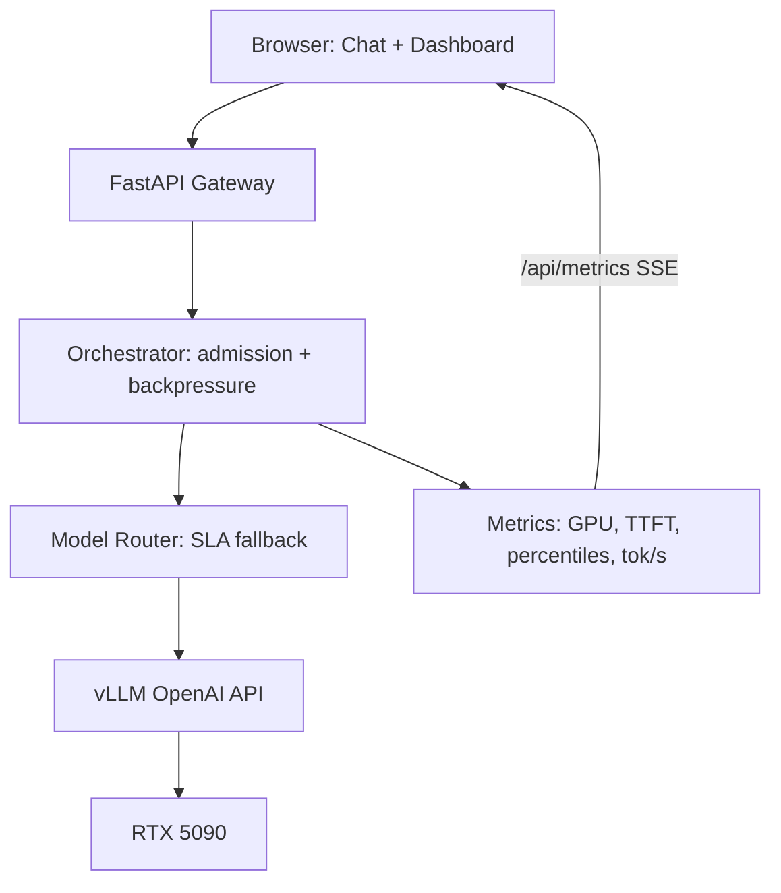

# LLM Inference Engineering Platform

Local inference stack: **Qwen2.5-VL** on **vLLM** (NVIDIA RTX 5090), with a FastAPI gateway for admission control, TTFT/latency metrics, GPU telemetry, optional multi-model SLA routing, and committed benchmark results.

## Architecture

```text
Browser (chat UI + /dashboard)
        |
        v
FastAPI gateway
  - AsyncOpenAI proxy
  - asyncio admission control (queue depth, concurrency ceiling, HTTP 429)
  - TTFT / wait / processing latency tracking
  - SLA-aware multi-model router
        |
        +-----> primary backend (vLLM: Qwen2.5-VL-7B)
        |
        +-----> optional fast backend (fallback under SLA breach)
        |
        v
NVIDIA RTX 5090 (WSL2 / CUDA)
```



## Features

| Feature | Details | Results |
| --- | --- | --- |
| Admission control | Bounded concurrency, queue depth, HTTP 429 | [`RESULTS.md`](RESULTS.md) |
| Metrics + dashboard | GPU util/VRAM, queue depth, tok/s, P50/P95/P99, TTFT | `/dashboard`, [`app/metrics.py`](app/metrics.py) |
| Streaming + TTFT | First-token latency in SSE `done` payload | — |
| Multi-model SLA routing | Fallback when p95 TTFT breaches SLA | [`router/RESULTS.md`](router/RESULTS.md) |
| Document ingest | PDF/DOCX/PPTX/XLSX/TXT parsed as text; scans + embedded images via vision | [`docs/DOCUMENT_INGEST.md`](docs/DOCUMENT_INGEST.md) |
| Quantization benchmarks | FP16 vs bitsandbytes INT8 vs AWQ INT4 | [`quantization/RESULTS.md`](quantization/RESULTS.md) |
| Prefill / decode timing | Measured cost split; disagg notes for single-GPU limits | [`disaggregation/RESULTS.md`](disaggregation/RESULTS.md) |

### Sample numbers (RTX 5090)

Text concurrency sweep via the gateway (`MAX_CONCURRENCY=8`) — see [`RESULTS.md`](RESULTS.md):

| Concurrency | ~Throughput (tok/s) | TTFT p50 | Total p50 |
| ---: | ---: | ---: | ---: |
| 1 | 138 | 67 ms | 2.1 s |
| 8 | 1043 | 82 ms | 2.1 s |
| 16 | 1043 | 843 ms | 2.9 s |

Throughput rises with concurrency up to the admission ceiling, then flattens while queue wait grows. GPU util ~98% at concurrency ≥ 4.

## Repository layout

```text
.
├── app/
│   ├── main.py              # FastAPI gateway (async, streaming, metrics)
│   ├── ingest.py            # Document parsing + vision fallbacks
│   ├── orchestrator.py      # Admission control + request tickets
│   ├── metrics.py           # NVML GPU + rolling latency/throughput
│   ├── router.py            # SLA-aware multi-backend routing
│   ├── static/              # Chat UI + /dashboard
│   ├── Dockerfile
│   └── requirements.txt
├── benchmarks/
│   ├── bench_client.py      # Async load generator → CSV
│   ├── plot_results.py
│   ├── router_load_test.py
│   ├── prefill_decode_probe.py
│   └── results/             # Committed CSVs + charts
├── RESULTS.md               # Orchestrator / concurrency findings
├── router/RESULTS.md
├── quantization/RESULTS.md
├── disaggregation/RESULTS.md
└── LICENSE
```

## Quick start

### Prerequisites

- Windows 11 + NVIDIA GPU (this project was measured on RTX 5090)
- WSL 2 (Ubuntu) with CUDA visible via `nvidia-smi`
- vLLM serving an OpenAI-compatible API (native venv or Docker)
- Python 3.11+ for the gateway

### 1. Serve the model (WSL)

Example (adjust path/venv to yours):

```bash
vllm serve Qwen/Qwen2.5-VL-7B-Instruct \
  --served-model-name Qwen/Qwen2.5-VL-7B-Instruct \
  --host 0.0.0.0 \
  --port 8080 \
  --dtype auto \
  --max-model-len 4096 \
  --gpu-memory-utilization 0.85 \
  --limit-mm-per-prompt '{"image":4}'
```

Verify:

```bash
curl http://127.0.0.1:8080/v1/models
```

> **Tip:** On this Blackwell + WSL2 setup, `--gpu-memory-utilization 0.9` left too little KV-cache headroom and crashed under concurrency ≥ 4. `0.85` held through concurrency 32. Details in [`RESULTS.md`](RESULTS.md).

### 2. Run the gateway

```bash
cd app
python -m venv .venv
# Windows: .venv\Scripts\activate
# WSL/Linux: source .venv/bin/activate
pip install -r requirements.txt
cp .env.example .env
# edit OPENAI_BASE_URL / MODEL_NAME if needed
uvicorn main:app --host 0.0.0.0 --port 3000 --reload
```

Open:

- Chat UI: http://127.0.0.1:3000
- Metrics dashboard: http://127.0.0.1:3000/dashboard
- JSON metrics: http://127.0.0.1:3000/api/metrics
- Router status: http://127.0.0.1:3000/api/router/status

### 3. Reproduce benchmarks

```bash
pip install -r benchmarks/requirements.txt
python benchmarks/bench_client.py \
  --base-url http://127.0.0.1:3000 \
  --concurrency 1 4 8 16 \
  --requests-per-level 16 \
  --out benchmarks/results/text_sweep.csv
python benchmarks/plot_results.py benchmarks/results/text_sweep.csv
```

## API surface

| Method | Path | Purpose |
| --- | --- | --- |
| `POST` | `/api/chat` | Chat completions (SSE streaming by default) |
| `POST` | `/api/ingest` | Parse PDF/Office/text uploads → `combined_text` + vision images |
| `GET` | `/api/ingest/formats` | Allowed extensions and ingest limits |
| `GET` | `/api/health` | Liveness + model endpoint |
| `GET` | `/api/models` | Upstream model list |
| `GET` | `/api/metrics` | Snapshot: GPU, queue, latency percentiles, tok/s |
| `GET` | `/api/metrics/stream` | Same payload over SSE (~1 Hz) |
| `GET` | `/api/router/status` | Per-backend SLA / degradation state |
| `GET` | `/dashboard` | Live Chart.js dashboard |

Environment knobs (see [`app/.env.example`](app/.env.example)):

| Variable | Role |
| --- | --- |
| `OPENAI_BASE_URL` / `VLLM_BASE_URL` | Upstream OpenAI-compatible base |
| `MODEL_NAME` | Primary served model id |
| `MAX_CONCURRENCY` | In-flight admission ceiling |
| `MAX_QUEUE_DEPTH` | Queue cap before HTTP 429 |
| `FAST_BASE_URL` | Optional fallback backend |
| `SLA_TTFT_MS` | p95 TTFT threshold that triggers spillover |

## Multi-model SLA routing

Set `FAST_BASE_URL` (+ `FAST_MODEL_NAME`) to enable a second backend. When the primary's rolling p95 TTFT exceeds `SLA_TTFT_MS`, new requests spill to `fast` instead of queueing forever.

On this single-GPU WSL2 host, launching two concurrent vLLM engines repeatedly crashed the GPU-passthrough VM (memory visibility mismatch). The router was still load-tested end-to-end against one physical engine with two independent admission controllers — see [`router/RESULTS.md`](router/RESULTS.md). Given a stable multi-engine host, the same code routes across distinct models/GPUs.

## Quantization and disaggregation

- **Quantization:** Qwen2.5-7B-Instruct in FP16, bitsandbytes INT8, and AWQ INT4 — see [`quantization/RESULTS.md`](quantization/RESULTS.md).
- **Prefill/decode:** measured timing vs prompt length; notes on vLLM `kv_transfer_config` and why a two-process run was not done on one GPU — [`disaggregation/RESULTS.md`](disaggregation/RESULTS.md).

## Docker (gateway only)

The FastAPI app can run in Docker while vLLM stays in WSL (or another host):

```bash
# from repo root — point OPENAI_BASE_URL at the host-published vLLM port
docker compose up -d --build
```

When the gateway is in Docker and vLLM is on the host, use `http://host.docker.internal:8080/v1`.

## Remote access (optional)

- **Tailscale Serve** — private to your tailnet
- **Tailscale Funnel** — public HTTPS; expose the FastAPI gateway only, never raw vLLM

Always put API keys / auth in front of any public Funnel URL.

## Security checklist

- Distinct secrets for gateway vs vLLM when both are exposed
- Never ship backend secrets into browser JS
- Bound `MAX_OUTPUT_TOKENS`, request timeouts, and queue depth
- Validate image size / MIME types (client enforces a 4MB upload cap for raw images; documents up to 25 MB server-side — watch Vercel body limits)
- Disable Funnel when not needed

## Document attachments (chat UI)

1. Attach `.pdf`, `.docx`, `.pptx`, `.xlsx`, `.txt`, etc. (or drag-drop).
2. The gateway extracts text, pulls embedded images from Word/PowerPoint, and rasterizes scan-like PDF pages.
3. The model receives **text blocks** plus **image_url** parts in one user message.

Legacy `.doc` / `.odt` / `.rtf` work **locally** when LibreOffice is installed (`SOFFICE_PATH`). See [`docs/DOCUMENT_INGEST.md`](docs/DOCUMENT_INGEST.md).

```powershell
cd app
python -m pytest tests/test_ingest.py -q
```

## Findings report (PDF)

A shareable write-up with architecture summary, tables, and all benchmark charts:

- [`docs/Inference_Engineering_Report.pdf`](docs/Inference_Engineering_Report.pdf)
- Regenerate: `python docs/generate_report_pdf.py`

## Deploy

**Recommended (same idea as [Ppttx maker](../Ppttx%20maker/docs/13-deploy-for-team.md)):** tunnel the **FastAPI gateway** on your PC (`:3000`), not only vLLM. Optional thin UI on Vercel with [`meta api-base`](app/static/index.html). Comparison: [`docs/VERCEL_LESSONS_FROM_DECK_BUILDER.md`](docs/VERCEL_LESSONS_FROM_DECK_BUILDER.md).

**Alternative:** run everything on Vercel (Python gateway) — see below; uploads and cold starts are more constrained.

### Tunnel gateway (easiest)

Production layout: **browser → Cloudflare → FastAPI (:3000) → private-llm tunnel → vLLM**.

```powershell
cd app
uvicorn main:app --host 127.0.0.1 --port 3000
# Cloudflare: new hostname -> http://localhost:3000
```

### Deploy to Vercel (all-in gateway)

Layout: **browser → Vercel (this gateway) → Cloudflare tunnel → vLLM on your PC**.

### 1. Keep inference online at home

```powershell
docker start vllm
Get-Service cloudflared   # org tunnel → https://private-llm.admindagency.com/v1
curl.exe https://private-llm.admindagency.com/v1/models
```

### 2. Push code

Ensure `main` includes root [`vercel.json`](vercel.json) (single FastAPI service in `app/`).

### 3. Create Vercel project (new account / team)

1. [vercel.com](https://vercel.com) → **Add New → Project** → import `germainsafari/Private-AI`.
2. **Root Directory:** `./` (repo root, not `app/` alone).
3. Framework may show **Services** — deploy using repo `vercel.json` (one `gateway` service).
4. **Environment variables** (Production + Preview):

| Variable | Example |
| --- | --- |
| `OPENAI_BASE_URL` | `https://private-llm.admindagency.com/v1` |
| `MODEL_NAME` | `qwen3.6-35b-a3b` (must match `GET …/v1/models`) |
| `API_KEY` | `not-needed` or your vLLM key |
| `MAX_UPLOAD_MB` | `10` on Hobby if large uploads fail |
| `MAX_VISION_IMAGES` | `12` |

5. **Deploy**, then verify:

```powershell
curl.exe https://YOUR-PROJECT.vercel.app/api/health
curl.exe https://YOUR-PROJECT.vercel.app/api/ingest/formats
```

Expect `"backend_reachable": true`, `"documents": true`.

6. Optional **custom domain** → Project → Settings → Domains.

### 4. What does *not* deploy to Vercel

- vLLM / Docker — stays on your machine.
- LibreOffice legacy conversion — local gateway only.
- LanguageTool — separate tunnel (`docs/LANGUAGETOOL.md`).

Full checklist: [`DEPLOY.md`](DEPLOY.md). Local funnel helper: [`scripts/start-wsl-vllm-and-funnel.ps1`](scripts/start-wsl-vllm-and-funnel.ps1). Render blueprint: [`deploy/render.yaml`](deploy/render.yaml) only.

## License

MIT — see [`LICENSE`](LICENSE).
