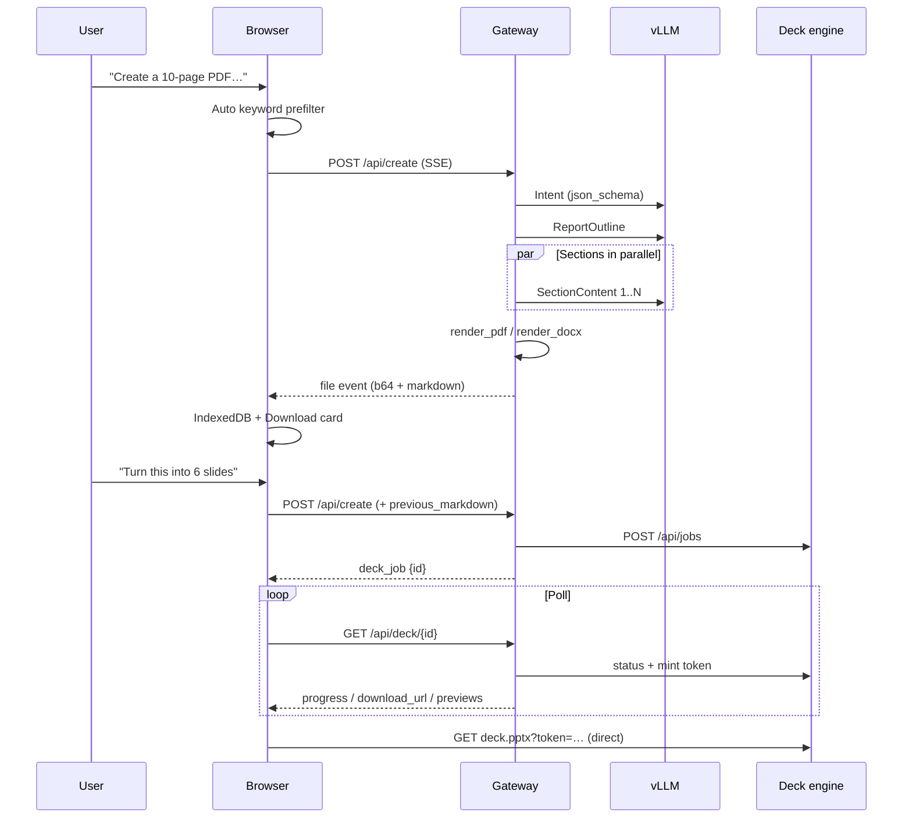

# File generation and editing

The chat can create and edit files. Downloads happen in the conversation: Open / Download cards, deck slide previews, and progress while work is running.

Related: document *reading* is [`DOCUMENT_INGEST.md`](DOCUMENT_INGEST.md). Deploy env vars: [`../DEPLOY.md`](../DEPLOY.md).

---

## Architecture (where each piece lives)

```text
Browser (app/static)
  │  Output chips: Auto / Chat / PDF / Word / Slides / Edit / Image
  │  IndexedDB holds generated blobs + markdown for revisions
  │
  ├─ POST /api/chat          ordinary Q&A (SSE tokens)
  ├─ POST /api/ingest        parse uploads → text (+ vision figures)
  ├─ POST /api/create        create / edit (SSE progress → file | deck_job)
  └─ GET  /api/deck/{id}     poll deck engine; mint signed download URLs
          │
          ▼
FastAPI gateway on Vercel (app/main.py)
          │
          ├─ creator.py          intent + pipelines
          ├─ llm_structured.py   JSON-schema calls to vLLM
          ├─ render_pdf.py / render_docx.py / charts.py / brand.py
          ├─ file_edit.py        DOCX/PPTX/XLSX/text edits
          ├─ deck_client.py ────► slides-api.admindagency.com (Ppttx maker)
          └─ images.py     ────► optional IMAGE_BASE_URL
                  │
                  ▼
      private-llm.admindagency.com/v1  →  Docker vLLM (qwen3.6-35b-a3b)
```



---

## End-to-end request path

### 1. UI decides whether to call `/api/create`

Composer chips (`#outputBar`) set `outputMode`.

| Mode | Behaviour |
| --- | --- |
| **Auto** | Client regex (EN + PL create/edit verbs + file nouns). Match → create; else chat. |
| **Chat** | Always `/api/chat`. |
| **PDF / Word / Slides / Edit / Image** | Force that `action` on `/api/create`. |

Chips that the server cannot serve are hidden after `GET /api/create/capabilities` (e.g. **Image** without `IMAGE_BASE_URL`, **Slides** without `DECK_ENGINE_URL`).

### 2. Multipart create request

`POST /api/create` fields:

| Field | Role |
| --- | --- |
| `prompt` | User message |
| `action` | `auto` or a concrete action |
| `history` | Last few turns (short) |
| `files` | Raw bytes to edit or to send to the deck engine |
| `previous_markdown` / `previous_kind` | Last generated report, for “add a section…” / “as Word instead” |

Uploaded files are also text-extracted with `ingest.parse_bytes` so the model can see their content without a separate ingest round-trip.

### 3. Server intent + pipeline

`Creator.run` (`app/creator.py`):

1. Cheap `wants_file` check (skipped when the chip forces a file action).
2. `Intent` via `llm_structured.structured` (vLLM `response_format` json_schema, thinking off).
3. Dispatch:

| `action` | Pipeline |
| --- | --- |
| `pdf_report` / `docx_document` | Outline → parallel sections → optional images → render |
| `presentation` | `deck_client.create_job` → `deck_job` event |
| `edit_file` | `EditPlan` → `file_edit.apply_edit` (PDF → regenerate report) |
| `image` | `images.generate_image` |
| `chat` | `{"type":"chat"}` → browser falls back to `/api/chat` |

SSE events: `progress`, `warning`, `keepalive`, `file`, `deck_job`, `error`, `done`.

### 4. Browser finishes the job

- **`file`**: decode base64 → IndexedDB → artifact card (Open / Download). Summary + `meta.artifacts` go into chat history; the binary does not.
- **`deck_job`**: poll `/api/deck/{id}` every ~4s; when `done`, show signed `download_url` and preview grid. PPTX is fetched **from the deck engine**, not through Vercel.
- Follow-ups that refer to “this / previous / ten…” reattach `previous_markdown` (or the editable blob) so the model revises instead of starting from scratch.

---

## Report pipeline (PDF / Word)

Designed for **large** documents without one giant LLM call.

1. **Length** — parse “N pages” from the prompt (or keep previous length on revise). Cap: `MAX_REPORT_PAGES` (40). Words ≈ pages × `REPORT_WORDS_PER_PAGE` (380).
2. **Outline** — `ReportOutline`: title, subtitle, executive summary bullets, `SectionPlan` list (heading, brief, target_words, visual).
3. **Sections** — up to `SECTION_CONCURRENCY` (6) parallel `SectionContent` calls. Each section gets a **relevant slice** of sources (`_relevant`), not the whole dump.
4. **Blocks** — paragraph, subheading, bullets, numbered, table, chart (bar/line/pie), callout, quote, optional image.
5. **Images** — only if the user asked *and* `IMAGE_BASE_URL` is set; max `MAX_REPORT_IMAGES` (4); JPEG-compressed for Vercel’s ~4.5 MB response limit.
6. **Render**
   - PDF: ReportLab (`render_pdf.py`) — cream cover, contents/bookmarks, coral `_` titles, teal tables, brand charts.
   - DOCX: python-docx (`render_docx.py`) — Acumin Pro styles, TOC field, charts as PNGs.
7. **Markdown twin** — `spec_to_markdown(spec)` is stored with the artifact so later edits have structure without re-parsing the PDF.

Fonts: Source Sans 3 (SIL OFL) under `app/assets/fonts/` for Polish and Latin Extended in PDFs. Brand assets under `app/assets/brand/` (same illustrations as the deck engine).

---

## Presentations (deck engine)

We do **not** rebuild PowerPoint branding in this repo. Presentations use the existing Admind deck engine ([Ppttx maker](../../Ppttx%20maker/docs/07-engine-api.md)).

1. Gateway `POST {DECK_ENGINE_URL}/api/jobs` with prompt, slide count, language, optional files + `context.txt`.
2. Auth: `X-API-Key` **or** HMAC bearer token from `DECK_ENGINE_TOKEN_SECRET` (same format as `engine/app/auth.py`).
3. Browser polls gateway `/api/deck/{id}`; gateway re-mints short-lived `?token=` links for `deck.pptx` and `previews/{n}.png`.
4. Large PPTX (~2 MB) never crosses Vercel’s body limit.

---

## Editing attached files

| Format | Strategy |
| --- | --- |
| DOCX / PPTX | Find/replace inside runs (bold/fonts survive); multi-run matches collapsed into first run |
| XLSX | `cell_edits` (sheet + A1) + string replace |
| TXT / MD / CSV / JSON | Full rewrite via `full_text` |
| PDF | Cannot edit in place → regenerate branded report from extracted text / previous markdown |

Output name: `original (edited).ext` (idempotent if already edited).

---

## Module map

| File | Responsibility |
| --- | --- |
| `app/main.py` | `/api/create`, `/api/deck/{id}`, `/api/create/capabilities`, health `file_creation` |
| `app/creator.py` | Intent, report/edit/deck/image pipelines, SSE events |
| `app/docspec.py` | Pydantic contracts (`Intent`, `ReportOutline`, `SectionContent`, `EditPlan`, …) |
| `app/llm_structured.py` | Strict JSON schema + strip `<think>` / fences + retry |
| `app/brand.py` | Palette, asset paths, PDF font registration |
| `app/charts.py` | ReportLab drawings → PDF/PNG |
| `app/render_pdf.py` / `render_docx.py` | Branded layouts |
| `app/file_edit.py` | Apply `EditPlan` |
| `app/deck_client.py` | Jobs, status, signed public URLs |
| `app/images.py` | Optional `/images/generations` |
| `app/static/js/app.js` | Chips, create SSE, IndexedDB, artifact / deck cards |
| `app/tests/test_create.py` | Render, edit, prefilter, token format (no GPU required) |

---

## Environment variables

| Variable | Required for | Notes |
| --- | --- | --- |
| `OPENAI_BASE_URL`, `MODEL_NAME` | Everything | On Vercel use the public tunnel, never `127.0.0.1` |
| `LLM_DISABLE_THINKING=1` | Structured JSON | Keeps Qwen3 from filling `reasoning` instead of `content` |
| `DECK_ENGINE_URL` | Slides | e.g. `https://slides-api.admindagency.com` |
| `DECK_ENGINE_TOKEN_SECRET` | Slides | Same as Ppttx maker `ENGINE_TOKEN_SECRET` |
| `IMAGE_BASE_URL` (+ key/model) | Images | Optional; prompts leave your box if hosted |
| `MAX_REPORT_PAGES`, `SECTION_CONCURRENCY` | Large PDFs | Defaults 40 / 6 |
| `MAX_CREATE_UPLOAD_BYTES` | Edits on Vercel | Default 4 MB |

Full list: [`app/.env.example`](../app/.env.example).

---

## Limits (Vercel + model)

| Constraint | Implication |
| --- | --- |
| ~4.5 MB request/response | Edit uploads capped; report images JPEG + few; decks download off-platform |
| ~300 s Fluid default | 40-page report ~2–3 min with concurrency 6 on RTX 5090 |
| Model context (65k) | Sources truncated / section-scoped; history trimmed |
| No LibreOffice on Vercel | Legacy `.doc`/`.odt`/`.rtf` only on a local gateway |

---

## How this was built (design story)

### Starting point

The gateway already had chat streaming, admission control, and **document ingest** (read PDF/Office into the prompt). Feedback asked for the reverse: the model should **create and edit** files—large branded PDFs, Admind presentations like Ppttx maker, downloads in the UI, and images only when asked.

### Key decisions

1. **Structured LLM output, not free-form Markdown → PDF.** vLLM `response_format` json_schema (same idea as the deck engine) fills pydantic models. Layout stays in Python; the model only fills content.
2. **Outline + parallel sections** instead of one huge completion — scales to tens of pages and streams progress.
3. **Reuse the deck engine** for PPTX — brand templates and animation already exist; the gateway only brokers jobs and signed links.
4. **Browser owns the bytes (IndexedDB)** — no server disk, Vercel stays stateless, revisions work offline for that tab.
5. **Images are opt-in and pluggable** — GPU is full with the LLM; no local image model. Explicit ask + `IMAGE_BASE_URL`.
6. **Edit preserves OOXML runs** — better than “regenerate the whole Word file” for small fixes.
7. **Brand parity with decks** — same palette and illustration assets; Source Sans 3 embedded for Polish in PDFs.

### Implementation order

1. Brand + ReportLab/DOCX renderers + chart helpers + fixture visual QA.
2. `llm_structured`, `docspec`, `creator` pipelines, `file_edit`, `deck_client`, `images`.
3. FastAPI SSE endpoints + health capabilities.
4. UI: chips, progress, artifact cards, deck polling, IndexedDB.
5. Tests (`pytest tests` — ingest + create), docs, Vercel env + redeploy, live verification.

### Production layout that works today

```text
Browser → https://private-ai-mu-woad.vercel.app (FastAPI)
              ├─→ https://private-llm.admindagency.com/v1  (vLLM)
              └─→ https://slides-api.admindagency.com      (deck engine)
```

Verify:

```powershell
curl.exe https://private-ai-mu-woad.vercel.app/api/health
curl.exe https://private-ai-mu-woad.vercel.app/api/create/capabilities
```

Expect `backend_reachable: true`, `file_creation.presentation: true`, and `model` matching vLLM.

---

## Local smoke test

```powershell
cd app
pip install -r requirements.txt
# app/.env → OPENAI_BASE_URL, MODEL_NAME, optional DECK_*
python -m pytest tests -q
uvicorn main:app --port 8011
# UI: http://127.0.0.1:8011 — try "Create a 5-page PDF…" or chip Slides
```
